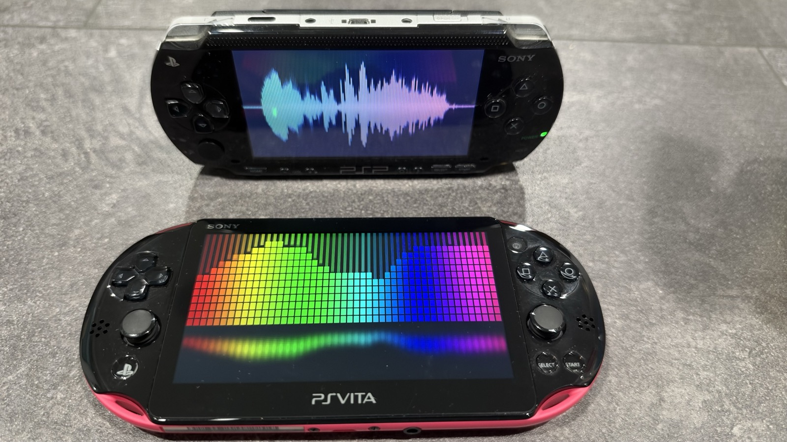
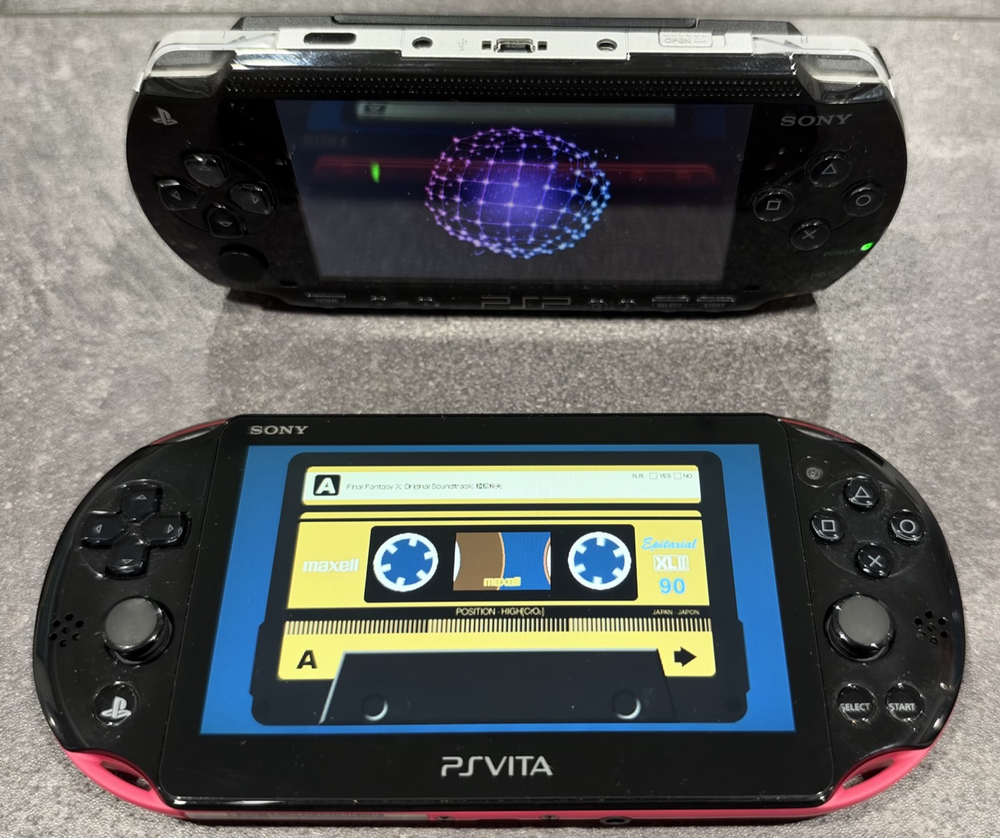
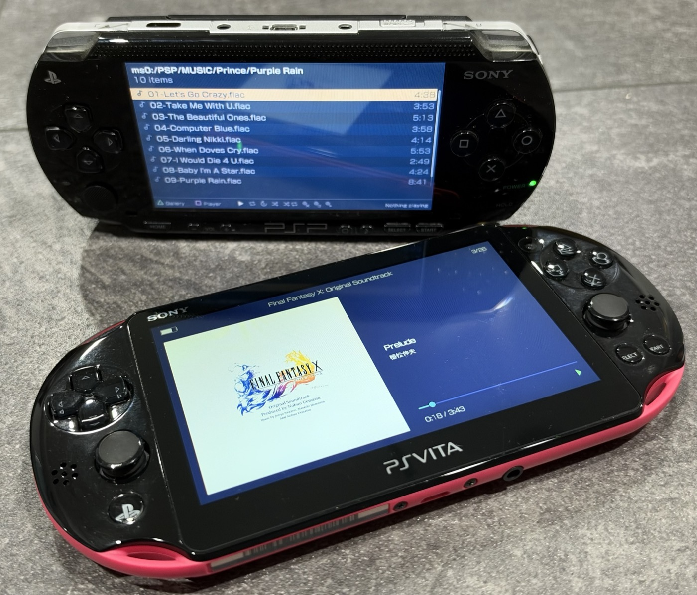
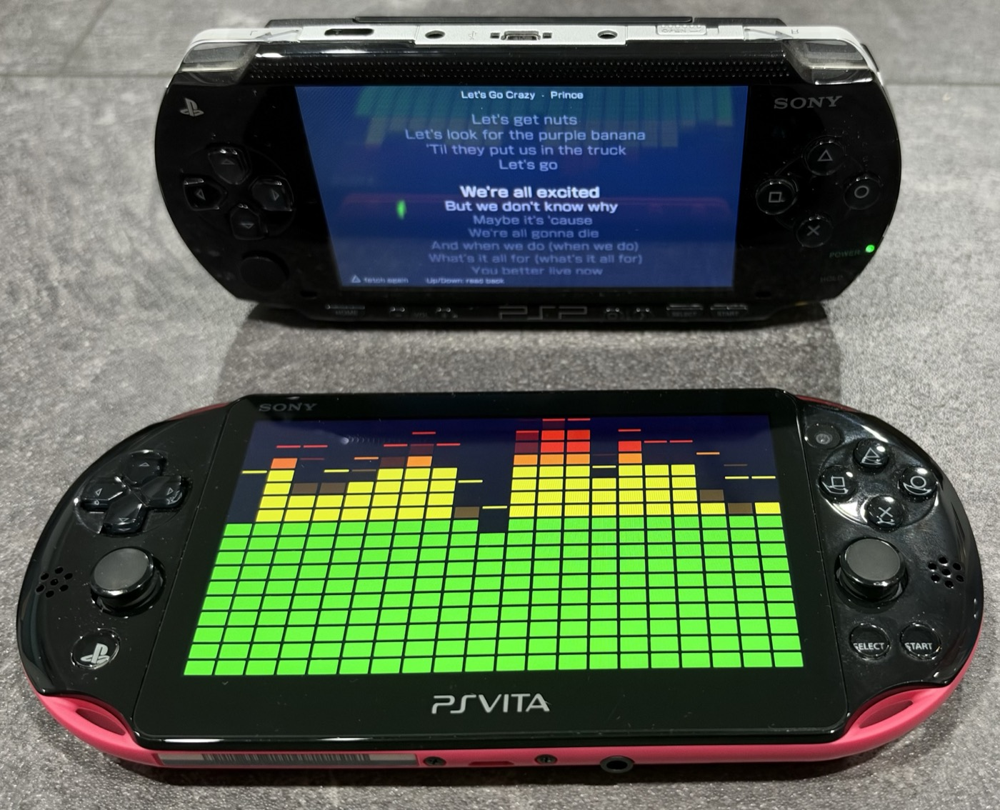
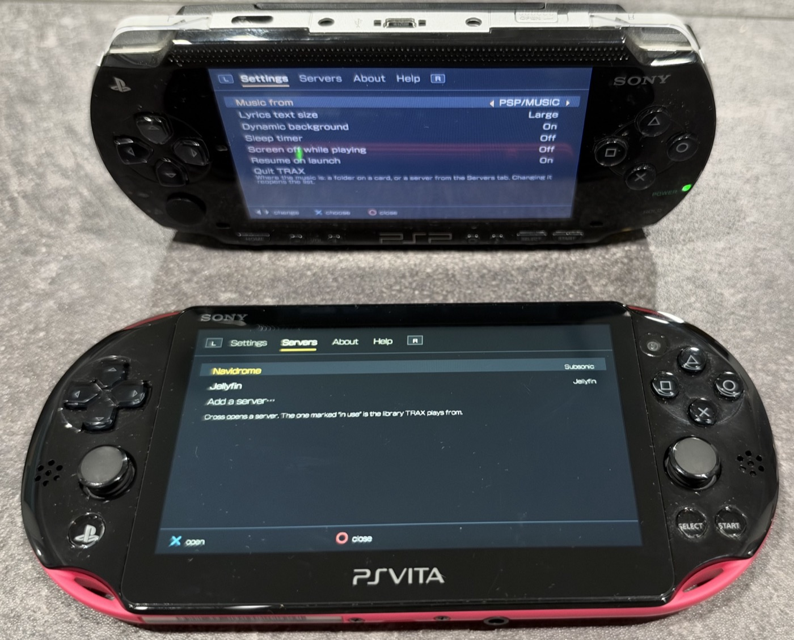

<h1 align="center">TRAX</h1>

  <strong>A music player for the Sony PSP and the PlayStation Vita.</strong> 
  Native on both — not a PSP app running under emulation.

  
  

  

It plays the files you already own, from the card already in the machine. No
converting, no companion app, no account. Tap Select and the screen becomes a
cassette deck whose reels wind in real time — or an orb, a starfield, or ribbons
of light moving to whatever is playing.

---

## Download

**[Get the latest release →](https://github.com/traxpsp/traxpsp/releases/latest)**

One zip, three builds. Take the one that matches your machine:

| Folder | For |
|---|---|
| `TRAX/` | A PSP with custom firmware (tested on ARK-4) |
| `TRAX OFW/` | A PSP that was never modified — signed, runs as-is |
| `TRAX Vita/TRAX.vpk` | A PlayStation Vita |

### Installing

**PSP** — copy the `TRAX` folder into `PSP/GAME` on the Memory Stick. It appears
in the XMB under Game › Memory Stick.

**Vita** — open `TRAX.vpk` with VitaShell and let it install.

Then put music on the card: `PSP/MUSIC` on a PSP, `ux0:/music` or a microSD at
`grw0:/MUSIC` on a Vita. That is the whole procedure.

---

## What it does

**Plays what you already have.** `.mp3`, `.wav`, `.flac`, `.m4a`, `.opus` and
`.at3`, straight off the card.

- **FLAC** natively, 8 to 32 bits a sample, up to **24-bit/192 kHz**
- **ALAC** and **AAC** in an `.m4a`
- **ATRAC3 / ATRAC3plus** — the PSP's own format, on its Media Engine
- **WAV** — PCM 8/16/24/32-bit, IEEE float, A-law, mu-law
- **Opus**, and **`.cue` albums** as a single entry that opens like a folder

**Thirteen visualizations.** A tape deck whose reels turn in time with the
music, analogue VU meters spaced by voltage the way a real face is, level
meters, an orb, a starfield, ribbons, glowing balls, LED bars, spectrum rays, a
waveform, a ring, a waterfall, and the words where the track has them.

**Cassette skins in JSON.** The shell, the label, the little window — rebuild a
tape you actually owned. Each machine gets its own artwork, drawn at its own
size.

**A ten-band equalizer.** 31 Hz to 16 kHz, each band one octave wide and ±12 dB,
adjustable while the music keeps playing.

**Global shuffle that walks the whole card.** It opens nothing while indexing,
which is why these are seconds and not minutes:

| | tracks | time |
|---|---|---|
| Vita, microSD at `grw0` | 1,615 | 1.66 s |
| PSP, Memory Stick | 1,663 | 2.43 s |

**An album gallery** — your covers as a wall of tiles or a shelf you walk along,
rather than as rows.

**Music from a server.** Subsonic (Navidrome, Airsonic, Gonic) and Jellyfin.

**And the small things that matter on a handheld** — a sleep timer that fades
over the last half minute, screen-off while playing so an album costs you the
battery it should, resume where you left off, the PSP's headphone remote
working with the screen off, and lyrics from an `.lrc` beside the track.

**New in 1.0.0:** a **Help** tab — every control in the app on one page, on the
machine, where you need it.

---

## Screenshots

<table>
  <tr>
    <td width="50%"></td>
    <td width="50%"></td>
  </tr>
  <tr>
    <td></td>
    <td></td>
  </tr>
</table>

---

## Requirements

**PSP** — a 1000, 2000 or 3000. Custom firmware recommended, tested on ARK-4.
It runs on an unmodified PSP too, giving up the music-note button, the volume
keys and screen-off.

**PS Vita** — homebrew-enabled (HENkaku). Reads internal storage (`ux0`), a
microSD adapter (`grw0`), or `uma0`.

Any card size. Mostly tested with a 64 GB microSD adapter.

---

## Documentation

- **[Manual](https://traxpspvita.wixsite.com/trax/user-manual)** — every screen and button
- **[Release notes](https://traxpspvita.wixsite.com/trax/release-notes)** — what changed, and why
- **[Website](https://traxpspvita.wixsite.com/trax)**

The manual, the release notes and the cassette skin format also ship inside
every release, so they work with no network.

---

## Something wrong?

**[Open an issue](https://github.com/traxpsp/traxpsp/issues)** — say which
machine, which firmware, and what the file was. TRAX keeps a log next to
itself, at `PSP/GAME/TRAX/trax.log` or `ux0:/data/trax/trax.log`, and attaching
it answers most questions in one go.

---

TRAX is free to use. The source is not published.

